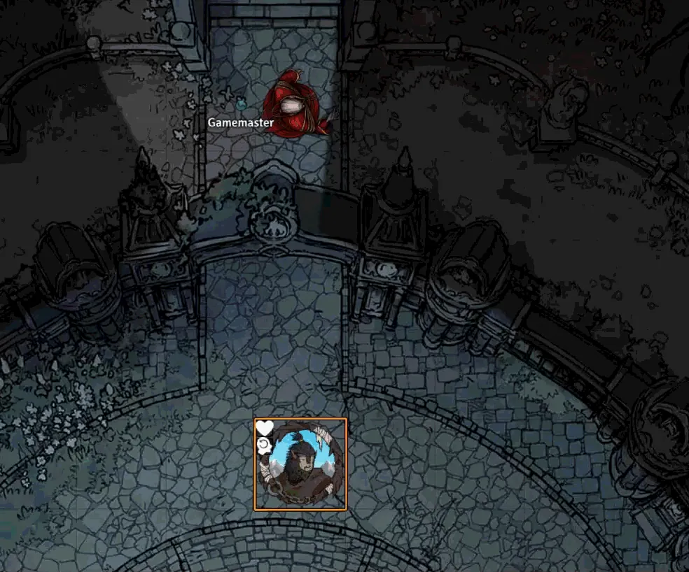
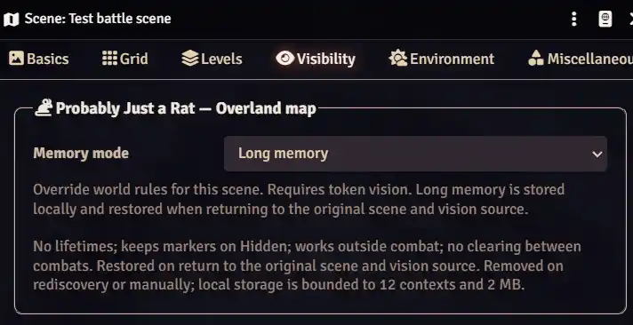
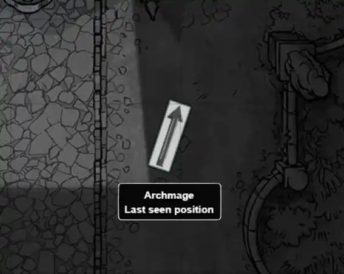

# Probably Just a Rat

Last-seen enemy ghosts for **Foundry VTT 14**. Works with any game system; requires token vision.



Ghosts stay where enemies were last seen and disappear on rediscovery. Each player has their own memory, preserved after F5. By default, positions expire after two combat rounds or one minute outside combat; ending combat clears them.

The rat button opens ping, camera and forget controls.

The GM chooses **Ghost**, **Boot prints**, **Position pin** or **Custom image** for all players in the module settings. **Rotate with movement** optionally turns any marker toward the token's last observed movement direction; the angle freezes after loss of sight. Off by default.

By default, hiding a token with **Hidden** removes its saved position. The GM can enable keeping known positions instead. Unseen tokens never create markers. In combat, captions keep the last-position label alongside the round counter.

The GM can open the current scene's **Visibility** tab using the button in **Memory rules**.

In **Scene Configuration → Visibility**, choose world rules, disable memory or enable **Long memory**. Long memory keeps known positions through Hidden, combat changes and F5 until rediscovery or manual removal.



Settings include **Marker**, **Memory rules** and **Captions and pings**. **Marker** offers an appearance preview even without saved enemies. Under **General**, each player can choose the module language.

For custom markers, select **Custom image** and choose an **Image file** in the module settings.



Install from the [Foundry catalog](https://foundryvtt.com/packages/probably-just-a-rat): open **Add-on Modules → Install Module** and search for **Probably Just a Rat**. Then enable the module in your world.

Alternatively, paste this URL into **Manifest URL**:

```text
https://github.com/wondersalmon/probably-just-a-rat/releases/latest/download/module.json
```

[Русский](README.ru.md) · [Changelog](CHANGELOG.md)
